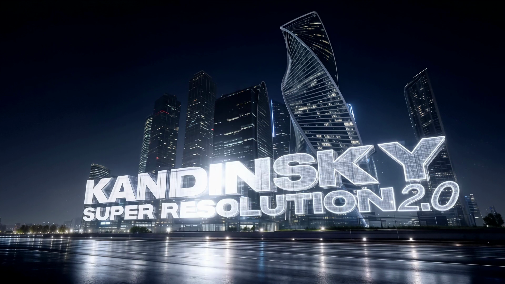
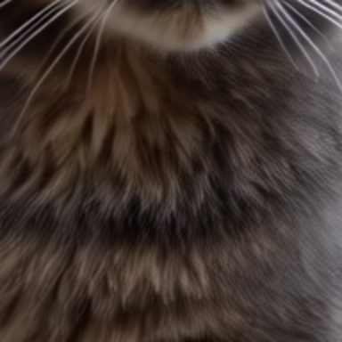
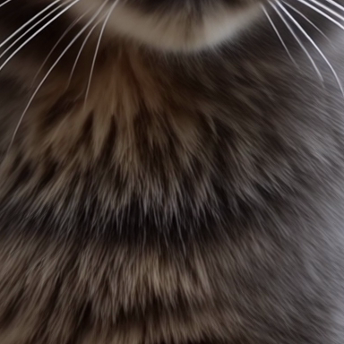

<div align="center">
  <a href="https://huggingface.co/kandinskylab/Kandinsky-6.0-VSR-2.0-distilled2steps-Diffusers/blob/main/assets/promo.mp4">
    
  </a>
  <br>
  <a href="https://huggingface.co/kandinskylab/Kandinsky-6.0-VSR-2.0-distilled2steps-Diffusers/blob/main/assets/promo.mp4"><b>▶ Watch the video</b></a>
</div>

<br>

<div align="center">
<picture>
  <source media="(prefers-color-scheme: dark)" srcset="assets/Kandinsky_SR_2.0_LOGO_V2_small_second_line_white.png">
  
</picture>
</div>

<br>

<div align="center">

<a href="https://kandinskylab.ai/"></a>
<a href="https://arxiv.org/abs/2610.05608"></a>
<a href="https://github.com/kandinskylab/kandinsky-6"></a>
<a href="https://huggingface.co/spaces/kandinskylab/Kandinsky-6.0-VSR-Demo"></a>
<a href="https://huggingface.co/collections/kandinskylab/kandinsky-60-vsr"></a>
<a href="https://huggingface.co/docs/diffusers/main/en/api/pipelines/kandinsky6#video-super-resolution"></a>
<a href="https://docs.vllm.ai/projects/vllm-omni/en/latest/api/vllm_omni/diffusion/models/kandinsky6_sr/"></a>
<a href="https://docs.sglang.io/cookbook/diffusion/Kandinsky/Kandinsky6-SR"></a>
<a href="https://haoailab.com/FastVideo/inference/kandinsky6_sr/"></a>
<a href="https://registry.comfy.org/nodes/kandinsky6-sr"></a>

</div>

# Kandinsky 6.0 Video Super-Resolution

Tiled video super-resolution for the **Kandinsky 6.0 Video** pipeline: **KVAE encode → latent upscaler → DiT (tiled) → KVAE decode**, x2 / x4 / x2.25 upscale of clips up to 15 seconds (361 frames at 24 fps; the model was trained on 5-second clips). Shipped as the `kandinsky-6-sr` package (import name `kandinsky_sr`) with the `kandy-sr` CLI; the [Kandinsky 6](https://github.com/kandinskylab/kandinsky-6) pipeline embeds it for generation-then-SR.

## 📰 News

- 2026/11/26: Released **Kandinsky 6.0 VSR 2.0** — [Kandinsky-6.0-VSR-2.0-distilled2steps-Diffusers](https://huggingface.co/kandinskylab/Kandinsky-6.0-VSR-2.0-distilled2steps-Diffusers): more natural generation and a noticeably cleaner x4 upscale (SD → 2K).
- 2026/10/23: Kandinsky 6.0 and Kandinsky 6.0 VSR are available in 🧨 [Diffusers v0.42.0](https://github.com/huggingface/diffusers/releases/tag/v0.42.0) (`Kandinsky6TI2VAPipeline`, `Kandinsky6SRPipeline`, `PiflowScheduler`).
- 2026/10/06: We open-sourced [**Kandinsky 6.0**](https://github.com/kandinskylab/kandinsky-6) and **Kandinsky 6.0 Video Super-Resolution**, together with the [technical report](https://arxiv.org/abs/2610.05608).

## 🚀 Getting Started

### Diffusers

Kandinsky 6.0 VSR ships in 🧨 Diffusers starting from v0.42.0:

```bash
pip install "diffusers>=0.42.0" transformers accelerate
```

`transformers` and `accelerate` are required: without `transformers` Diffusers exposes `Kandinsky6SRPipeline` only as a placeholder that fails on `from_pretrained`, and without `accelerate` the transformer cannot keep its fp32 modules while loading.

> [!IMPORTANT]
> With the distilled checkpoints, always pass `num_inference_steps=2`. They are distilled for exactly 2 model evaluations per tile, but `Kandinsky6SRPipeline` defaults to 4 steps (the flow-matching setting) and does not take the step count from the bundle, so leaving the argument out runs the model off its trained schedule. `kandy-sr` and the ComfyUI nodes read it from the bundle and need nothing extra.

```python
import torch
from diffusers import Kandinsky6SRPipeline
from diffusers.utils import export_to_video, load_video

torch._inductor.config.max_autotune = True  # required: lets inductor pick flex-attention tiles that fit the SR block mask

pipe = Kandinsky6SRPipeline.from_pretrained(
    "kandinskylab/Kandinsky-6.0-VSR-2.0-distilled2steps-Diffusers", dtype=torch.bfloat16
)
pipe.enable_model_cpu_offload()
pipe.transformer.set_attention_backend("flex")
pipe.transformer.compile_repeated_blocks(fullgraph=True)

video = load_video("lq.mp4")  # -> list[PIL.Image.Image], 1 + 4k frames (e.g. 121)
output = pipe(
    video=video,
    resolution_scale=2.25,  # 2, 2.25 or 4
    num_inference_steps=2,  # required, see the note above
    generator=torch.Generator("cuda").manual_seed(1137),
)
export_to_video(output.frames[0], "lq_sr.mp4", fps=24)
```

The Diffusers pipeline is video-only; mux the source audio back in if you need it. A step-by-step version is in `notebooks/sr_inference_example_diffusers.ipynb`. See the [Diffusers Kandinsky 6 docs](https://huggingface.co/docs/diffusers/main/en/api/pipelines/kandinsky6#video-super-resolution) for details.

The model also runs in [vLLM-Omni](https://docs.vllm.ai/projects/vllm-omni/en/latest/api/vllm_omni/diffusion/models/kandinsky6_sr/), [SGLang](https://docs.sglang.io/cookbook/diffusion/Kandinsky/Kandinsky6-SR) and [FastVideo](https://haoailab.com/FastVideo/inference/kandinsky6_sr/).

### Manual setup (this repository)

The `kandy-sr` CLI and the `kandinsky_sr` package run the same bundles with extra speedups (NABLA CuteDSL, tiled `split` / MagiCompiler KVAE), audio passthrough, delivery-resolution resizing and ComfyUI nodes.

#### 1. Install

Install the base package from GitHub. The default KVAE backend is the tiled `split` VAE. NABLA defaults to CuteDSL (`nabla: cutedsl`) when flash-attn-4 is installed, and stays on the block-64 kernel otherwise:

```bash
pip install "kandinsky-6-sr[flash4] @ git+https://github.com/kandinskylab/kandinsky-6-sr"
# CUDA 13: pip install "kandinsky-6-sr[flash4-cu13] @ git+https://github.com/kandinskylab/kandinsky-6-sr"
```

`flash-attn-4` provides `flash_attn.cute`, which FlexAttention `BACKEND=FLASH` imports. If that extra cannot be installed, install flash-attn 2 instead. NABLA then uses the block-64 kernel, and the dense flash paths use FA2:

```bash
pip install "kandinsky-6-sr[flash] @ git+https://github.com/kandinskylab/kandinsky-6-sr"
```

In a checkout, `just setup` does the same: it installs flash-attn-4 (the `flash4-cu13` extra on CUDA 13) and falls back to flash-attn 2 when that install fails.

With the MagiCompiler KVAE backend (`vae_backend: magi`, Linux with NVIDIA CUDA):

The `[magi]` extra installs the supporting dependencies. MagiCompiler itself is
not available on PyPI and must be installed separately from its `v1.1.0` Git tag
(the older `v1.0.0` is not compatible):

```bash
pip install "kandinsky-6-sr[magi] @ git+https://github.com/kandinskylab/kandinsky-6-sr"
# pip install "kandinsky-6-sr[magi]"
pip install "setuptools>=61.0" wheel versioningit
pip install --no-build-isolation "magi_compiler @ git+https://github.com/SandAI-org/MagiCompiler.git@v1.1.0"
```

Install the system Graphviz executable as well (Ubuntu/Debian: `sudo apt install graphviz`).
In a checkout, `just setup-magi` installs both the extra and MagiCompiler.
For a locally built wheel, replace the first command with
`pip install "./dist/kandinsky_6_sr-1.0.0-py3-none-any.whl[magi]"`.
Select `vae_backend: magi` in the config to enable it.

#### 2. Setup config

```yaml
# sr_config.yaml
sr:
  checkpoint_path: kandinskylab/Kandinsky-6.0-VSR-2.0-distilled2steps-Diffusers
  resolution_scale: 2      # 2, 4 or 2.25
  device: cuda:0
```

The models are published as Diffusers bundles: one repository holds the SR DiT, the KVAE and the x2 / x4 latent upscalers, and `checkpoint_path` alone loads all three (downloaded into the HF cache on first use). Three bundles are available — the 2-step π-Flow distilled VSR 2.0 [Kandinsky-6.0-VSR-2.0-distilled2steps-Diffusers](https://huggingface.co/kandinskylab/Kandinsky-6.0-VSR-2.0-distilled2steps-Diffusers) (recommended), the first π-Flow release VSR 1.0 [Kandinsky-6.0-VSR-distilled2steps-5s-Diffusers](https://huggingface.co/kandinskylab/Kandinsky-6.0-VSR-distilled2steps-5s-Diffusers), and the flow-matching teacher [Kandinsky-6.0-VSR-5s-Diffusers](https://huggingface.co/kandinskylab/Kandinsky-6.0-VSR-5s-Diffusers); a local copy of a bundle works the same way (`checkpoint_path: /path/to/bundle`).

`vae_path` and `latent_upscaler_config` are only needed to take those models from somewhere else, e.g. `vae_path: kandinskylab/Kandinsky-6.0-VSR-5s-Diffusers/vae`. All parameters: [Config parameters](#config-parameters-sr-section).

#### 3. Run Inference

```bash
kandy-sr from-video --config sr_config.yaml --input lq.mp4 --output-dir outputs

# any config value can be overridden from the CLI, e.g. the GPU and x4 upscale
kandy-sr from-video --config sr_config.yaml --input lq.mp4 --output-dir outputs \
    --device "cuda:0" --resolution-scale 4 --vae-backend magi
```

`--config` can be replaced by the `KANDY_SR_CONFIG` env var; explicit CLI options override the YAML (`kandy-sr from-video --help` lists them).

> **Note** (`vae_backend: magi`): if the run fails with `RuntimeError: CUDA driver error: invalid argument`, the MagiCompiler cache holds artifacts built for another GPU / torch build — point it at a fresh directory: `MAGI_COMPILE_CACHE_ROOT_DIR=/path/to/new_cache_dir kandy-sr ...`.

From Python (see `notebooks/sr_inference_example.ipynb`):

```python
from kandinsky_sr.pipeline.factory import load_sr_pipeline

sr_pipeline = load_sr_pipeline("sr_config.yaml", device="cuda:0", force=True)
result = sr_pipeline(video=frames_tchw_uint8, source_video="lq.mp4", save_path="outputs/sr.mp4")
```

Several equal-shaped clips go through in one call: pass `video` as a `[B, T, 3, H, W]` tensor (or a list of clips) and `save_path` / `source_video` as lists — see `notebooks/sr_batch_inference_example.ipynb`.

`load_sr_pipeline` also accepts an `SRConfig`; pass `offload=` (any `kandinsky_sr.core.utils.offload.OffloadHandle`) to let the host pipeline manage module residency — the DiT, KVAE and latent upscaler are registered as `dit`, `vae`, `latent_upscaler`.

## ComfyUI

For ComfyUI, install [kandinsky6-sr](https://registry.comfy.org/nodes/kandinsky6-sr) through **ComfyUI Manager**, then restart ComfyUI.
The `comfyui/` directory contains extension source code; no manual copying is needed — see the [setup guide](comfyui/README.md) and [manual model downloads](comfyui/README.md#manual-downloads).

## Inference Time on H100

Measured with the 2-step distilled SR DiT of VSR 1.0 ([Kandinsky-6.0-VSR-distilled2steps-5s-Diffusers](https://huggingface.co/kandinskylab/Kandinsky-6.0-VSR-distilled2steps-5s-Diffusers); VSR 2.0 has the same architecture and step count) on a 5-second (121 frames, 24 fps) 768×512 clip, torch 2.10.0+cu128, with the KVAE decode precompiled at load (`kandy-sr` default) and `--warmup`. 
The time covers the SR pass itself (whole-clip KVAE encode, per-tile latent upscale, DiT and KVAE decode, and Hanning-blend stitching), excluding model load, warmup, video reading and saving.

| Input (W×H) | Scale | Output (W×H) | Tiles | Time |
|:---:|:---:|:---:|:---:|:---:|
| 768×512 | ×2 | 1536×1024 | 9 | 41 s |
| 768×512 | ×4 | 3072×2048 | 25 | 118 s |

## Config parameters (`sr:` section)

<details>
<summary>Full parameter reference</summary>

Schema: `src/kandinsky_sr/pipeline/config.py::SRConfig`. The same section works in a standalone SR YAML and inside a full k6 pipeline config.

| Parameter | Default | Description |
|---|---|---|
| `checkpoint_path` | — (required) | The SR DiT: a `Kandinsky6SRPipeline` Diffusers bundle — a Hugging Face repo id (e.g. [`kandinskylab/Kandinsky-6.0-VSR-2.0-distilled2steps-Diffusers`](https://huggingface.co/kandinskylab/Kandinsky-6.0-VSR-2.0-distilled2steps-Diffusers)) or a local copy of it — whose `transformer/` and `scheduler/` folders are read. A native DiT checkpoint works too: a dir with `model.safetensors` + `config.yaml`, a `.safetensors`/`.pt` file, or a sharded `model/` dir. |
| `vae_path` | the bundle's `vae/` | Video KVAE. Unset = the VAE of the `checkpoint_path` bundle. Otherwise a bundle (repo id or local dir), its component (`<repo>/vae` or a local `vae/` dir), or a native KVAE: a sidecar pair (`{prefix}.yaml` + `{prefix}.safetensors` / `{prefix}.ckpt`, given as the prefix or its directory) or the `config.json` + `model.safetensors` layout of the public KVAE 2.0 checkouts. Required with a native DiT checkpoint. |
| `latent_upscaler_config` | the bundle's `latent_upscaler/` | Latent upscalers (x2 and x4). Unset = the bank of the `checkpoint_path` bundle. Otherwise a bundle (repo id or local dir), its component (`<repo>/latent_upscaler` or a local `latent_upscaler/` dir), or a native LU bank YAML (architectures + checkpoints; relative `checkpoint:` entries resolve against the YAML's directory) or the directory holding it. `"none"` disables the LU (pixel path). Required with a native DiT checkpoint. |
| `resolution_scale` | `2.25` | Total upscale factor: `2`, `4`, or `2.25` (x1.125 pixel pre-upscale + x2 tiling). |
| `num_steps` | `5` | Denoising grid points per tile (N points = N−1 steps). Ignored by π-Flow-distilled checkpoints (they run at the trained nfe). |
| `vae_backend` | `split` | KVAE compilation backend: `split` (tiled torch.compile KVAE; encode and decode tile internally, so `decode_spatial_splits` is forced to 1), `torch` (per-block torch.compile), or `magi` (MagiCompiler, needs the `magi` extra and separate compiler installation). |
| `nabla` | `cutedsl` | Sparse self-attention. `cutedsl` mean-pools each 8×16 tile, takes top-cdf and runs FlexAttention CuteDSL at block 128 (needs flash-attn-4). Without that package the load stays on `flex`, the block-64 NABLA. |
| `device` | `cuda:0` | CUDA device the pipeline runs on; `--device` overrides. |
| `seed` | `42` | Noise seed (per-tile-chunk deterministic). |
| `tiles_batch_size` | `1` | Tiles per DiT call; larger = better GPU utilisation, more peak memory. |
| `overlap` | `0.20` | Minimum overlap between neighbouring tiles as a fraction of the tile size; the grid uses the fewest tiles with uniform overlap ≥ this. |
| `decode_segment_frames` | `0` (backend default) | Pixel frames per temporal segment of the KVAE decode (`torch` backend only). Smaller segments cut decoder peak memory; `0` keeps the backend default (`KVAE_DECODE_SEG`, 16). |
| `decode_spatial_splits` | `1` | Vertical strips the KVAE decode is split into; each strip is decoded on its own and the strips are cross-faded. `1` decodes the whole tile at once; `2` roughly halves decoder peak memory. |
| `decode_spatial_overlap` | `4` | Latent columns of overlap between neighbouring decode strips (16 px per column); the cross-fade hides the strip seams. Ignored with `decode_spatial_splits: 1`. |
| `lu_load_scales` | `null` (all) | Bank entries (by `target_scale`, e.g. `["2x"]`) loaded eagerly at startup; unlisted entries lazy-load on first use. |
| `target_resolution` | `null` (raw) | Downscale the SR result to a delivery tier (`hd` / `fullhd` / `2k`) or an explicit `WxH`. |
| `target_resize_mode` | `fit` | `fit` preserves aspect exactly; `exact` resizes to the precise bucket dimensions. |
| `instruct_type_override` | `noise` | Post-load DiT `instruct_type` override (`noise` starts denoising from the LQ latent); `null` keeps the checkpoint config's value. |
| `dit_overrides` | `null` | Extra `KEY: VALUE` attribute overrides applied to the loaded DiT via `setattr`. |
| `enabled`, `mode`, `kvae_bridge`, `source_vae_path` | — | k6-embedded route only (`kandy generate` with SR); ignored by the standalone `kandy-sr` CLI. |

Model-contract values (trained fps/frame budget, base resolutions, delivery-tier tables) are intentionally **not** configurable — they live in `constants.py`.

</details>

## Inference Pipeline

<div align="center">

</div>

The input video is encoded once with the KVAE-3D-2.0-t4s16 video tokenizer and the LQ latent is split into an overlapping tile grid. Each tile is upscaled by the learned latent upscaler (×2 / ×4), mixed with variance-preserving noise (the LQ-latent degradation the model was trained on) and used as the starting point of the denoising loop — the SR DiT predicts the velocity and an Euler step moves the latent towards t→0 (the distilled checkpoint needs 2 evaluations, the flow-matching one a few more). Every denoised tile is KVAE-decoded, and the HQ tiles are stitched back with Hanning-window blending.

Any input resolution works. The latent path needs the clip on the KVAE stride (16 px) and at least one tile wide and high, so the pipeline pads it bottom/right with a mirrored strip before the encode and crops the stitched result back to exactly `source × scale` — callers never resize or align their videos.

## Examples VSR 2.0

<details>
<summary>Show the VSR 2.0 examples</summary>

Outputs of the VSR 2.0 2-step distilled SR DiT ([Kandinsky-6.0-VSR-2.0-distilled2steps-Diffusers](https://huggingface.co/kandinskylab/Kandinsky-6.0-VSR-2.0-distilled2steps-Diffusers)) on generated 768×512 clips. The second row zooms into the same region of one frame (the LR crop is upscaled bicubically to the SR size).

| LR input (768×512) | SR ×2 output (1536×1024) |
|:---:|:---:|
| <video src="https://github.com/user-attachments/assets/b04a25c8-37c6-4da4-8208-34cd7d4a140b" controls width="480"></video> | <video src="https://github.com/user-attachments/assets/3936775e-3b40-4633-9519-ea1da13e6c4e" controls width="480"></video> |
|  |  |
| *crop, bicubic ×2* | *crop, SR ×2* |

| LR input (768×512) | SR ×4 output (3072×2048) |
|:---:|:---:|
| <video src="https://github.com/user-attachments/assets/a3b85b5d-3b6f-45cf-ab3c-d6fa6ce884b6" controls width="480"></video> | <video src="https://github.com/user-attachments/assets/5a377c9d-aa5c-4ecc-98a4-968bf9dda99e" controls width="480"></video> |
|  |  |
| *crop, bicubic ×4* | *crop, SR ×4* |

</details>

## Examples VSR 1.0

<details>
<summary>Show the VSR 1.0 examples</summary>

Outputs of the first release of the 2-step distilled SR DiT ([Kandinsky-6.0-VSR-distilled2steps-5s-Diffusers](https://huggingface.co/kandinskylab/Kandinsky-6.0-VSR-distilled2steps-5s-Diffusers)) on 768×512 clips generated by Kandinsky 6.0 Video. The second row zooms into the same region (the LR crop is upscaled bicubically to the SR size).

| LR input (768×512) | SR ×2 output (1536×1024) |
|:---:|:---:|
| <video src="https://github.com/user-attachments/assets/db2e8148-08be-4834-9c89-9f16b4e14e4c" controls width="480"></video> | <video src="https://github.com/user-attachments/assets/0aa4eaf5-0bf8-4f88-80db-054f675c62d5" controls width="480"></video> |
|  |  |
| *crop, bicubic ×2* | *crop, SR ×2* |

| LR input (768×512) | SR ×4 output (3072×2048) |
|:---:|:---:|
| <video src="https://github.com/user-attachments/assets/337834ed-60c8-4f39-ad11-3204454017a7" controls width="480"></video> | <video src="https://github.com/user-attachments/assets/736340d3-319d-4ba4-bd2e-df58d0c38dce" controls width="480"></video> |
|  |  |
| *crop, bicubic ×4* | *crop, SR ×4* |

</details>

## License

This project is licensed under the [MIT License](LICENSE). Diffusers export templates retain their Apache-2.0 notices; see [LICENSE-APACHE](LICENSE-APACHE).

## Citation

If you use this model in your research or applications, please cite the Kandinsky 6.0 technical report:

```bibtex
@misc{kandinsky2026kandinsky60videofoundation,
      title={Kandinsky 6.0 Video: Foundation Models for Synchronized Video and Audio Generation},
      author={Team Kandinsky},
      year={2026},
      eprint={2610.05608},
      archivePrefix={arXiv},
      primaryClass={cs.CV},
      url={https://arxiv.org/abs/2610.05608},
}
```
